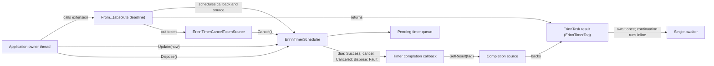

# ErinnTask

ErinnTask is a small asynchronous library for .NET. It provides the custom awaitable types `ErinnTask` and `ErinnTask<T>`, plus a manually driven timer scheduler that can complete those awaitables.

The timer scheduler is deliberately caller-driven: it does not create a thread, own a clock, or wait in the background. Your application supplies absolute timestamps and calls `Update` from the scheduler's owning thread.

## Contents

- [What the library provides](#what-the-library-provides)
- [Features this library does not provide](#features-this-library-does-not-provide)
- [Use cases and API selection](#use-cases-and-api-selection)
- [Installation and target frameworks](#installation-and-target-frameworks)
- [Quick start: ErinnTask](#quick-start-erinntask)
- [Quick start: timer callbacks](#quick-start-timer-callbacks)
- [Awaitable timers](#awaitable-timers)
- [Timer and awaitable relationship](#timer-and-awaitable-relationship)
- [Timer timestamps and conversions](#timer-timestamps-and-conversions)
- [Cancellation and timer tokens](#cancellation-and-timer-tokens)
- [Disposal and resource lifetime](#disposal-and-resource-lifetime)
- [Exceptions](#exceptions)
- [Threading and continuation behavior](#threading-and-continuation-behavior)
- [Integration patterns and operational guidance](#integration-patterns-and-operational-guidance)
- [Allocation and performance notes](#allocation-and-performance-notes)
- [Public API map](#public-api-map)
- [Common mistakes](#common-mistakes)
- [Guidance for AI agents and contributors](#guidance-for-ai-agents-and-contributors)
- [Building and packing](#building-and-packing)
- [License](#license)

## What the library provides

The public API is in the `Erinn` namespace.

| Type                          | Purpose                                                                                                                           |
|-------------------------------|-----------------------------------------------------------------------------------------------------------------------------------|
| `ErinnTask`                   | An awaitable operation with no result. It is also the async return type for methods declared as `async ErinnTask`.                |
| `ErinnTask<T>`                | An awaitable operation that produces a `T` result. It is also the async return type for methods declared as `async ErinnTask<T>`. |
| `ErinnTimerScheduler`         | Stores timers and invokes callbacks when the caller advances the scheduler with `Update`.                                         |
| `ErinnTimerCancelTokenSource` | A value handle that can cancel one pending timer and invoke its callback with a cancellation tag.                                 |
| `ErinnTimerTag`               | The timer callback result: `Success`, `Canceled`, or `Fault`.                                                                     |
| `ErinnTaskTimerExtensions`    | Extension methods that create `ErinnTask<ErinnTimerTag>` timers from absolute timestamps.                                         |

`ErinnTask` is not a wrapper around `System.Threading.Tasks.Task` or `ValueTask`. It has no implicit conversion to those types, no `ConfigureAwait`, no built-in `CancellationToken` support, and no `WhenAll` or `WhenAny` combinators. It can be awaited inside a regular `Task`-returning method, and an `ErinnTask`-returning method can await `Task`, `ValueTask`, or another awaitable that follows the C# awaiter pattern.

## Features this library does not provide

These limits are part of the current API contract:

- **Task and ValueTask adapters:** `ErinnTask` is its own awaitable type. There are no implicit conversions or built-in adapters to or from `Task`/`ValueTask`, though each type can be awaited in a compatible async method.
- **Task convenience APIs:** There is no `ConfigureAwait`, `WhenAll`, `WhenAny`, or built-in `CancellationToken` integration. The timer token is a separate value handle and cancellation completes with an `ErinnTimerTag`.
- **Automatic or relative timers:** The scheduler has no clock, delay-based overload, background timer thread, or wake-up mechanism. It accepts absolute timestamps and runs only when the application calls `Update`.
- **Recurring timers:** Each scheduled entry is one-shot. A callback can schedule another entry, but the application chooses its next deadline and catch-up policy.
- **Background work scheduling:** An `async ErinnTask` method starts synchronously and the library does not automatically queue it to the thread pool. Resumption follows the awaited operation's scheduling behavior.
- **Concurrent scheduler use:** One scheduler instance is unsynchronized and single-thread-affine. The `[ThreadAffine]` attribute is metadata; it does not enforce thread ownership at runtime.
- **Context or thread dispatch:** ErinnTask's own awaiter does not capture contexts or dispatch work. In an async ErinnTask method, the awaited type's awaiter controls resumption; for example, a standard `Task` awaiter may capture the current synchronization context. ErinnTask-backed timer continuations run inline.

## Use cases and API selection

ErinnTask is a good fit when an application already owns a regular update loop and wants to advance timers from that loop without creating a timer thread. Supplying timestamps explicitly also makes timer progress controllable: a test or simulation can advance a chosen clock value and observe which callbacks run.

Choose the API that matches how the operation is consumed:

| Need                                                                                                            | Use                                                                      | Notes                                                                                      |
|-----------------------------------------------------------------------------------------------------------------|--------------------------------------------------------------------------|--------------------------------------------------------------------------------------------|
| An async method that returns no value or one result                                                             | `ErinnTask` or `ErinnTask<T>`                                            | Treat source-backed results as single-consumption awaitables.                              |
| A timer that invokes an action and does not need an `await` result                                              | `ErinnTimerScheduler.Create<T>`                                          | The callback receives a terminal tag and its typed payload.                                |
| An async method that waits for a scheduled deadline                                                             | `FromMicroseconds`, `FromMilliseconds`, `FromSeconds`, or `FromTimeSpan` | These return `ErinnTask<ErinnTimerTag>`; the scheduler still needs regular `Update` calls. |
| Standard task combinators, `CancellationToken` APIs, broad library interoperability, or ordinary background I/O | `Task` or `ValueTask`                                                    | ErinnTask can await these types, but does not provide their surrounding APIs.              |
| A timer that must wake the process or run independently of an application loop                                  | A platform timer or another autonomous scheduler                         | ErinnTask's scheduler does not own a clock, thread, or wake-up mechanism.                  |

### Good fit

- Frame-based delays, gameplay cooldowns, and timeouts owned by a game, UI, or other regular single-threaded update loop.
- Deterministic tests and simulations that need to advance a caller-controlled clock value.
- Internal async APIs where consumers understand the one-consumption rule and inline continuation behavior.

### Choose another primitive when

- A deadline must wake a sleeping process or run without a regularly driven owner loop.
- Callers require standard `Task`/`ValueTask` combinators, `CancellationToken` integration, or context capture when awaiting ErinnTask's own operations.
- Multiple threads must schedule, update, cancel, or dispose the same timer scheduler concurrently.

For public APIs consumed by arbitrary .NET code, weigh these constraints against the benefits of a custom awaitable before exposing `ErinnTask` directly.

## Installation and target frameworks

Install the published package with:

```sh
dotnet add package ErinnTask
```

When installing a locally built package from the repository root, use:

```sh
dotnet add package ErinnTask --source ./ErinnTask/nupkgs
```

The project currently builds package assets for `net10.0`, `net9.0`, `net8.0`, `net7.0`, `net6.0`, `net5.0`, and `netstandard2.1`. The `netstandard2.1` target declares `System.Runtime.CompilerServices.Unsafe` as a package dependency.

## Quick start: ErinnTask

An async method can return either task type. It starts executing synchronously and continues until it returns or reaches an await that is not already complete.

```csharp
using Erinn;

static async ErinnTask<int> AddAsync(int left, int right)
{
    await ErinnTask.CompletedTask;
    return left + right;
}

static ErinnTask<int> GetCachedValue() => ErinnTask.FromResult(42);
```

The default value of `ErinnTask` is a successfully completed operation. The default value of `ErinnTask<T>` is also complete and contains `default(T)`. `ErinnTask.FromResult<T>(value)` creates an already completed `ErinnTask<T>` that stores its result inline.

Use `await` to observe a result or rethrow an exception reported by an async method:

```csharp
static async ErinnTask<int> CalculateAsync()
{
    int cached = await GetCachedValue();
    return await AddAsync(cached, 1);
}
```

### Single-consumption rule

An operation backed by a pooled source can be consumed once. Await each source-backed `ErinnTask` or `ErinnTask<T>` exactly once. Do not await multiple copies, call `GetAwaiter().GetResult()` and then await the same operation, or register multiple continuations. Copies of the struct share the same source and version; consuming one copy consumes them all. Reusing a consumed or stale copy can throw `InvalidOperationException`.

Inline completed values such as `ErinnTask.CompletedTask` and values returned by `ErinnTask.FromResult` do not use a pooled source. The safe general rule for an operation returned by another method is still to treat it as single-consumption unless that method explicitly documents otherwise.

An async method that throws records the exception in its returned operation. The exception is rethrown when that operation is awaited or its result is otherwise consumed. A method that creates a timer can also throw synchronously while validating or scheduling the timer, before returning the awaitable.

## Quick start: timer callbacks

Create one scheduler for the thread that will own it, schedule timers with absolute timestamps, and call `Update` from that thread. This example uses microseconds as the application's chosen clock unit:

```csharp
using System;
using System.Diagnostics;
using Erinn;

static ulong NowMicroseconds()
{
    ulong ticks = (ulong)Stopwatch.GetTimestamp();
    ulong frequency = (ulong)Stopwatch.Frequency;

    return ticks / frequency * 1_000_000UL
         + ticks % frequency * 1_000_000UL / frequency;
}

using (ErinnTimerScheduler scheduler = ErinnTimerScheduler.Create())
{
    scheduler.OnException = static exception => Console.Error.WriteLine(exception);

    ulong nowMicroseconds = NowMicroseconds();
    ulong deadline = nowMicroseconds + 2_000_000UL;
    ErinnTimerCancelTokenSource token = scheduler.Create(
        deadline,
        static (tag, message) => Console.WriteLine($"{message}: {tag}"),
        "cache refresh");

    // Call this regularly from the same application loop that owns the scheduler.
    scheduler.Update(nowMicroseconds);

    // If the timer is still pending, this invokes its callback immediately with Canceled.
    bool canceled = token.Cancel();
}
```

The single `Update` in this short example only advances the scheduler once. A real application should call `Update` regularly from its game loop, UI loop, or other owner-thread loop. The scheduler does not wake itself up when a deadline passes.

`ErinnTimerScheduler.Create<T>` accepts an absolute `ulong` timestamp, a non-null `Action<ErinnTimerTag, T?>`, and a payload. When a scheduled timer is eventually fired, canceled, or drained by scheduler disposal, its callback is invoked once. A timer remains pending if none of those actions occurs. The payload is passed to the callback and is not boxed by the scheduler.

Timers are ordered by timestamp. Timers with the same timestamp run in scheduling order. A callback may schedule another timer; if its timestamp is already due, it can also run during the same `Update` call.

## Awaitable timers

The timer extension methods return `ErinnTask<ErinnTimerTag>` and provide a cancellation token through an `out` parameter. The scheduler still has to be driven by the application.

### Timer and awaitable relationship

The extension method schedules a callback on the timer scheduler and returns an awaitable backed by a completion source. The cancellation token refers to that same scheduled entry:



`Update` completes due timers with `Success`, cancellation completes a pending timer with `Canceled`, and disposal drains pending timers with `Fault`. These are successful task results carrying status tags; callback or continuation exceptions use the exception path described below.

```csharp
using Erinn;

static async ErinnTask<ErinnTimerTag> WaitUntilAsync(
    ErinnTimerScheduler scheduler,
    ulong deadlineMicroseconds)
{
    ErinnTask<ErinnTimerTag> timer = scheduler.FromMicroseconds(deadlineMicroseconds, out _);
    return await timer;
}
```

Call this method from application flow and keep advancing the scheduler from its normal owner-thread loop, as shown in [Quick start: timer callbacks](#quick-start-timer-callbacks). When `Update` reaches the deadline, the operation completes with `Success`; a continuation registered by `await` runs inline inside that `Update` call.

The terminal-tag meanings and their behavior during cancellation and disposal are compared in [Cancellation and timer tokens](#cancellation-and-timer-tokens). Timer completion returns a status tag successfully; callback or continuation exceptions use the scheduler's exception policy described below.

## Timer timestamps and conversions

Every timer timestamp is an **absolute timestamp**, not a delay. The scheduler has no clock and does not calculate `now + delay`. Pick a monotonic time source, define one origin and unit, and pass timestamps from that same domain to scheduling and `Update`.

`ErinnTimerScheduler.Create(timestamp, ...)` and `Update(timestamp)` use raw `ulong` values. They accept any value from zero through `ulong.MaxValue`. The unit is defined by the caller; the scheduler compares values without conversion. Timestamps passed to `Update` do not have to be monotonic. Each call runs timers whose scheduled timestamp is less than or equal to that call's value.

The awaitable extensions normalize timestamps to **microseconds** internally. When using any of these extensions, call `Update` with the matching absolute timestamp expressed in microseconds, regardless of which extension you used:

| Extension                                      | Input                                           | Conversion and limits                                                                                                                    |
|------------------------------------------------|-------------------------------------------------|------------------------------------------------------------------------------------------------------------------------------------------|
| `FromMicroseconds(ulong timestamp, out token)` | Absolute microseconds                           | No conversion; every `ulong` value is accepted.                                                                                          |
| `FromMilliseconds(ulong timestamp, out token)` | Absolute milliseconds                           | Multiplied by 1,000; accepted range is `0` through `ulong.MaxValue / 1_000`, inclusive.                                                  |
| `FromSeconds(double timestamp, out token)`     | Absolute seconds                                | Must be finite and non-negative. The converted value must be less than `2^64` microseconds. Fractional microseconds are truncated.       |
| `FromTimeSpan(TimeSpan timestamp, out token)`  | An absolute timestamp represented by `TimeSpan` | Must be non-negative. Ticks are divided by 10; sub-microsecond ticks are truncated. Result is at most `long.MaxValue / 10` microseconds. |

For example, if `nowMicroseconds` is your current absolute time, schedule a 250 ms deadline as either:

```csharp
ErinnTask<ErinnTimerTag> timer = scheduler.FromMicroseconds(
    nowMicroseconds + 250_000UL,
    out ErinnTimerCancelTokenSource token);
```

or:

```csharp
ulong deadlineMilliseconds = nowMicroseconds / 1_000UL + 250UL;
ErinnTask<ErinnTimerTag> timer = scheduler.FromMilliseconds(
    deadlineMilliseconds,
    out ErinnTimerCancelTokenSource token);
```

For seconds and `TimeSpan`, the input is also an absolute timestamp. With a synthetic clock whose origin is zero, these two calls schedule the same deadline:

```csharp
// Inside an async method, with a live scheduler owned by this thread.
double nowSeconds = 12.5d;
TimeSpan nowTimeSpan = TimeSpan.FromMilliseconds(12_500);

ErinnTask<ErinnTimerTag> secondsTimer = scheduler.FromSeconds(
    nowSeconds + 0.25d,
    out _);
ErinnTask<ErinnTimerTag> timeSpanTimer = scheduler.FromTimeSpan(
    nowTimeSpan + TimeSpan.FromMilliseconds(250),
    out _);

scheduler.Update(12_750_000UL);
ErinnTimerTag secondsResult = await secondsTimer; // Success
ErinnTimerTag timeSpanResult = await timeSpanTimer; // Success
```

The example uses a shared zero origin: `12.75` seconds and `12,750` milliseconds both convert to `12,750,000` microseconds. In all cases, `scheduler.Update` must receive the absolute time in microseconds; conversion does not change the scheduler's update unit.

A timestamp of zero is still queued normally. It completes only after an `Update` call reaches that timestamp, a cancellation, or scheduler disposal.

## Cancellation and timer tokens

`ErinnTimerCancelTokenSource` is an immutable value handle. It is not `System.Threading.CancellationTokenSource` and does not remove a timer silently.

- `token.Cancel()` returns `true` when it canceled a timer that was still pending. The timer callback runs immediately with `ErinnTimerTag.Canceled` on the calling thread.
- It returns `false` for a default token, a timer that already fired or was canceled, or a timer owned by a disposed scheduler.
- A token's `IsValid` property means that it was created for a timer. It does **not** report whether the timer is still pending. Use the return value from `Cancel` when that distinction matters.
- Repeated cancellation is harmless and returns `false` after the first successful cancellation.
- Use the token only on the scheduler's owning thread. Timer tokens are not thread-safe.

| Event                                   | Callback tag and timing                                 | `Cancel()` result                            | Awaitable timer result                                                               |
|-----------------------------------------|---------------------------------------------------------|----------------------------------------------|--------------------------------------------------------------------------------------|
| `Update` reaches or passes the deadline | `Success`, during `Update`                              | `false` if called after completion           | Completes with `Success`                                                             |
| `Cancel()` is called while pending      | `Canceled`, inline on the calling thread                | `true` if callback handling returns normally | Completes with `Canceled`                                                            |
| `Dispose()` drains a pending timer      | `Fault`, inline during disposal                         | `false` if called after disposal             | Completes with `Fault`                                                               |
| Default token                           | No callback; no timer is associated                     | `false`                                      | No associated operation                                                              |
| Timer already completed                 | No callback from this call; completion already happened | `false`                                      | No new completion; any earlier `Success`, `Canceled`, or `Fault` result is unchanged |

`Canceled` and `Fault` are successful awaitable results, not thrown cancellation or fault exceptions. Cancellation removes the timer before invoking its callback. If the callback or configured `OnException` handler throws, `Cancel()` propagates that exception after the timer has already been removed, so no Boolean result is returned.

The token is immutable and does not clear itself after completion. Avoid retaining completed tokens longer than necessary, especially when they keep a disposed scheduler reachable.

## Disposal and resource lifetime

`ErinnTimerScheduler` implements `IDisposable`. Dispose it on its owning thread when it is no longer needed, usually with `using` or `using` declarations.

Disposal marks the scheduler closed, invokes every still-pending timer callback with `ErinnTimerTag.Fault`, releases queue and bucket storage, and releases the exception handler reference. Repeated calls after the first are no-ops, including when the first call threw an `AggregateException` after cleanup.

After disposal:

- `Create` and the awaitable timer extensions throw `ObjectDisposedException`.
- `Update` is ignored.
- `Cancel` returns `false`.
- Scheduling from a callback that is running during the disposal drain throws `ObjectDisposedException`.

Do not dispose a scheduler while application code still expects it to accept timers. Pending awaitable timers complete with `Fault` during disposal, so consume each returned task once if you need to observe that outcome.

## Exceptions

Timer callback exceptions are handled by the scheduler that invoked the callback:

1. If `OnException` is set, the scheduler passes the callback exception to the current handler. If the handler returns normally, `Update` continues processing other due timers.
2. If `OnException` is `null`, the callback exception propagates from `Update` or `Cancel`. The timer was already removed and is not restored.
3. If `OnException` itself throws, that exception propagates from `Update` or `Cancel` and stops that operation.
4. During `Dispose`, pending timers are still drained. Callback exceptions without a handler, and exceptions thrown by the handler, are collected and thrown together as an `AggregateException` after storage cleanup.

The callback handler is a single `Action<Exception>` property. Replacing it affects later exception reports. The property is cleared during disposal.

For an application loop that should log callback errors and continue processing due timers, set a handler that returns normally:

```csharp
using System;
using Erinn;

internal static class TimerErrorHandling
{
    public static void ConfigureLogging(ErinnTimerScheduler scheduler)
    {
        scheduler.OnException = static exception => Console.Error.WriteLine(exception);
    }
}
```

Call `ConfigureLogging` once when initializing the scheduler, then keep calling `Update` from the owner loop. If `OnException` is left `null`, catch exceptions around `Update` or `Cancel` when the caller needs to handle them there. If a callback exception or the handler throws during `Dispose`, catch the resulting `AggregateException`; disposal finishes draining and releases scheduler storage before throwing it.

`ErinnTimerTag.Fault` is not how callback exceptions are reported. It means that a timer was pending when the scheduler was disposed. If an await continuation throws while a timer completes, that exception propagates through the timer callback path and is handled by `OnException` or by the triggering scheduler operation.

## Threading and continuation behavior

### `ErinnTask` operations

- ErinnTask's own awaiter does not capture `ExecutionContext` or `SynchronizationContext`. In an async method returning ErinnTask, the awaited type's awaiter controls scheduling; a standard `Task` awaiter may capture the current synchronization context by default.
- When a source-backed ErinnTask completes with a continuation registered, that continuation runs inline on the completing thread. If it is registered after completion, it runs inline on the registering thread.
- Completion can race with continuation registration; the stored continuation is invoked once.
- A source-backed operation supports one continuation registration and one result consumption. Concurrent consumers or multiple continuation registrations are unsupported.
- Completion and continuation registration may occur on different threads. This does not make a timer scheduler thread-safe.

For ErinnTask-backed operations, inline continuations can re-enter the code that completed the operation. Keep continuation work bounded and account for the resumption thread in code after `await`.

### `ErinnTimerScheduler`

One scheduler instance is single-thread-affine and unsynchronized. Create, schedule, update, cancel, set its exception handler, and dispose it from the same owning thread. Concurrent access from multiple threads is unsupported. The internal thread-affinity attribute is metadata only; it does not perform runtime checks or add synchronization.

Timer callbacks run inline on the thread calling `Update`, `Cancel`, or `Dispose`. A pending awaitable timer resumes on the thread that completes it, usually the scheduler thread calling `Update`. ErinnTask does not dispatch back to the thread or synchronization context that awaited it. If application work must run on another thread or context, dispatch it explicitly using the application's own mechanism.

## Integration patterns and operational guidance

### Drive the scheduler from one owner loop

Create the scheduler alongside the game, UI, or event-loop component that owns it. On each loop iteration, read the same monotonic clock used to calculate deadlines and call `Update` with that absolute timestamp. A timer becomes eligible when an update reaches or passes its deadline; it does not run at an exact wall-clock instant. If the loop is paused or delayed, the callback waits until the next update.

Keep scheduling, `Update`, cancellation, exception-handler changes, and disposal on that owner thread. If another thread requests cancellation, send the request to the owner loop and call `Cancel` there. The Boolean result tells whether that call removed a still-pending timer; it does not make cross-thread access safe.

`Cancel` invokes the timer callback synchronously. For an awaited timer, that callback can run the waiting continuation inline before `Cancel` returns, so update the owning component's state before calling it.

### Await one timer result and handle all terminal tags

The returned timer operation is a one-shot operation. Store it, await it exactly once, and handle its terminal status. This example maps `Success` to `true` and both non-success statuses to `false`:

```csharp
static async ErinnTask<bool> WaitForDeadlineAsync(
    ErinnTimerScheduler scheduler,
    ulong deadlineMicroseconds)
{
    ErinnTask<ErinnTimerTag> timer = scheduler.FromMicroseconds(
        deadlineMicroseconds,
        out _);

    ErinnTimerTag tag = await timer;
    return tag == ErinnTimerTag.Success;
}
```

If an owning component needs cancellation, create the timer there, retain the returned token, and give the one-shot operation to a single consumer. Call `Cancel` on the scheduler's owner thread. The timer operation still needs to be consumed once so its completion source can be returned to the pool. Treat `Canceled` and `Fault` as outcomes that the caller must interpret; neither is a thrown cancellation exception.

### Define recurring-timer behavior yourself

Timers are one-shot. A callback may schedule another timer, and a newly scheduled timer whose deadline is already due can run later in the same `Update` call. A callback that repeatedly schedules another already-due timer can therefore keep that update loop running indefinitely. For recurring work, explicitly choose whether missed intervals should catch up or be skipped, advance the next deadline accordingly, and bound catch-up work when necessary.

### Keep clock arithmetic and time units consistent

Use one monotonic clock and one origin for both deadlines and `Update`. Do not mix Unix timestamps, elapsed time from process start, frame counters, milliseconds, and microseconds without an explicit conversion. The raw callback API compares caller-provided `ulong` values directly; the awaitable extension methods convert their input to microseconds.

The scheduler accepts all raw `ulong` timestamps, but the application is responsible for computing deadlines safely. For `deadline = now + delay`, check that the addition does not overflow `ulong`; a wrapped deadline sorts near zero and can fire much earlier than intended. For wall-clock/calendar deadlines, convert them into the chosen monotonic clock domain rather than passing `DateTime`-style epoch values directly.

### Bound work performed by callbacks and continuations

Callbacks and continuations execute inline. A long-running callback delays the rest of the due timers and the caller of `Update`. An awaited timer's continuation may also schedule more work, cancel other timers, or otherwise re-enter application code before the current `Update` returns. Keep this work bounded and make state transitions safe for that ordering.

When no `OnException` handler is installed, a callback exception propagates and stops the current `Update`; the throwing timer is already removed, while other due timers remain queued for a later update. If `OnException` is installed and returns normally, processing continues. Choose this policy deliberately for the owning loop.

## Allocation and performance notes

The library is designed to avoid unnecessary allocations on common paths, but it does not promise that every operation is allocation-free.

- `ErinnTask.CompletedTask` and `ErinnTask.FromResult<T>` store completed values inline and do not rent completion storage.
- Suspended async methods use pooled state-machine runners and completion sources. Their pools are per thread and per closed generic type.
- After warm-up, successful operations within the available pool capacity can avoid managed allocations in Release builds. Initial pool setup, pool or timer storage growth, Debug state machines, and exception paths can allocate.
- Timer payloads are stored without boxing. Timer queues, buckets, callback delegates, and first-use initialization can still allocate.
- A capturing lambda creates a delegate/closure as required by normal C# semantics. Reuse a cached delegate or a static lambda when profiling shows callback allocation matters.

Measure the real call pattern and build configuration before making allocation claims. Do not infer zero-GC behavior from the fact that the task types are structs or that a callback payload is not boxed.

## Public API map

| API                                                                   | Behavior                                                                                                  | Threading contract                                                                                                   |
|-----------------------------------------------------------------------|-----------------------------------------------------------------------------------------------------------|----------------------------------------------------------------------------------------------------------------------|
| `ErinnTask.CompletedTask`                                             | Completed non-generic operation.                                                                          | No scheduler affinity; completes synchronously.                                                                      |
| `ErinnTask.FromResult<T>(T result)`                                   | Completed `ErinnTask<T>` with an inline result.                                                           | No scheduler affinity; completes synchronously.                                                                      |
| `ErinnTask.GetAwaiter()` / `ErinnTask<T>.GetAwaiter()`                | Awaiter entry points used by the C# compiler. Manual consumption must follow the single-consumption rule. | No fixed thread affinity; source-backed operations allow one consumer and completion/registration may cross threads. |
| `ErinnTimerScheduler.Create()`                                        | Creates a new independent scheduler. The constructor is not public.                                       | Choose the thread that will own it; subsequent scheduler operations stay on that thread.                             |
| `ErinnTimerScheduler.Create<T>(ulong, Action<ErinnTimerTag, T?>, T?)` | Schedules a callback with a payload and returns its cancellation token.                                   | Scheduler owner thread only; callback runs inline on the thread that triggers it.                                    |
| `ErinnTimerScheduler.Update(ulong)`                                   | Runs all timers due at or before the supplied absolute timestamp.                                         | Scheduler owner thread only; callbacks and continuations run inline.                                                 |
| `ErinnTimerScheduler.OnException`                                     | Gets or sets the single timer callback exception handler.                                                 | Read and write on the scheduler owner thread.                                                                        |
| `ErinnTimerScheduler.Dispose()`                                       | Completes all pending timer callbacks with `Fault` and releases scheduler storage.                        | Scheduler owner thread only; pending callbacks run inline during disposal.                                           |
| `ErinnTimerCancelTokenSource.Cancel()`                                | Cancels one pending timer and invokes its callback with `Canceled`.                                       | Scheduler owner thread only; a registered continuation can run inline before return.                                 |
| `ErinnTimerTag`                                                       | Status value returned to a timer callback or awaiter: `Success`, `Canceled`, or `Fault`.                  | Plain enum value; no thread affinity.                                                                                |
| `ErinnTaskTimerExtensions.FromMicroseconds(...)`                      | Creates an awaitable timer from an absolute microsecond timestamp.                                        | Call on the scheduler owner thread; a pending await resumes on the completion thread.                                |
| `ErinnTaskTimerExtensions.FromMilliseconds(...)`                      | Converts an absolute millisecond timestamp to microseconds and creates an awaitable timer.                | Call on the scheduler owner thread; a pending await resumes on the completion thread.                                |
| `ErinnTaskTimerExtensions.FromSeconds(...)`                           | Converts an absolute finite, non-negative seconds timestamp to microseconds.                              | Call on the scheduler owner thread; a pending await resumes on the completion thread.                                |
| `ErinnTaskTimerExtensions.FromTimeSpan(...)`                          | Converts a non-negative absolute `TimeSpan` timestamp to microseconds.                                    | Call on the scheduler owner thread; a pending await resumes on the completion thread.                                |

## Common mistakes

- **Passing a duration as a timestamp.** Compute `deadline = now + delay` using the same clock and unit as the future `Update` calls.
- **Updating in the wrong unit.** The `FromMilliseconds`, `FromSeconds`, and `FromTimeSpan` methods convert their input to microseconds. `Update` must still use microseconds for those timers.
- **Expecting an automatic timer thread.** The application must call `Update`; no timer fires while the scheduler is not being advanced.
- **Treating `Canceled` or `Fault` as exceptions.** They are `ErinnTimerTag` values returned by the awaitable timer.
- **Assuming an await resumes on its original context.** Continuations run inline on the completion thread; no context is captured.
- **Using one scheduler from multiple threads.** Keep all operations on its owning thread or marshal them there yourself.
- **Awaiting a source-backed operation twice.** Consume it once, even if multiple struct copies exist.
- **Assuming `token.IsValid` means pending.** It only means the token was created; `Cancel()` reports whether it canceled a live timer.
- **Assuming callback exceptions are swallowed.** Configure `OnException` deliberately or handle the exceptions that propagate from `Update`, `Cancel`, and `Dispose`.
- **Assuming `FromTimeSpan` accepts a delay.** It represents an absolute timestamp relative to the same origin used by `Update`.

## Guidance for AI agents and contributors

Use this section as the repository-specific operating contract when helping with ErinnTask.

### When using the library

1. Select `ErinnTask` for no result and `ErinnTask<T>` for a result. Use `await`; do not assume Task-specific APIs or implicit conversions exist.
2. Treat source-backed operations as one-shot. Do not duplicate consumption or register more than one continuation.
3. Treat every timer input as an absolute timestamp. Define the clock origin and unit, convert explicitly, and keep `Update` in that same domain. The extension methods use microseconds after conversion.
4. Keep a scheduler and its cancellation tokens on one owner thread. Do not assume the thread-affinity marker enforces this at runtime.
5. Handle `Success`, `Canceled`, and `Fault` as distinct status values. They are not exceptions.
6. Remember that continuations and callbacks run inline. Avoid blocking work and be explicit about reentrancy and dispatch to other contexts.
7. Decide how callback exceptions should be handled by setting `OnException` or by handling exceptions from the triggering operation.

### When changing this repository

1. Read the existing implementation and XML documentation before changing a contract. This README summarizes public behavior; the source remains authoritative if a detail changes.
2. Keep changes local to a demonstrated need. Do not add runtime checks, synchronization, abstractions, or allocations solely for hypothetical future use.
3. Follow the existing exception conventions: use `ThrowHelpers` and `SR` for established validation paths, and do not rename `ExceptionArgument` values as unrelated cleanup.
4. Preserve the one-continuation/one-consumption lifecycle and the rule that pooled sources are not reused until active calls return.
5. Keep timer queue, bucket, token, and disposal operations single-thread-affine unless the entire scheduler design is deliberately changed and validated. The thread-affinity attribute is metadata only.
6. Preserve exception paths: callbacks are removed before invocation; `OnException`, `Update`, `Cancel`, and `Dispose` have different propagation behavior.
7. Do not claim thread safety, context capture, cancellation exceptions, automatic clocking, or zero allocations unless the implementation and a representative verification demonstrate it.
8. New C# files named after generic types must include the type's generic arity in the filename. For example:

   ```text
   ErinnTimerEntry`1.cs
   ```

9. Preserve the existing line-ending style of C# files. Do not change unrelated public APIs or introduce a base class solely for hypothetical future types.
10. Validate library changes against the project file, not only against a helper or isolated internal operation. Report exactly which public path a test exercises; do not alter private state to manufacture a test case.
11. The package is multi-targeted. Build `ErinnTask/ErinnTask.csproj` for all configured targets when a change can affect compatibility. Do not switch to building the solution as a substitute for checking the library project.
12. Release builds create a NuGet package and the current project target clears and recreates the configured `nupkgs` directory before packing. Do not put unrelated user files in that output directory.
13. Keep examples and public documentation aligned with the actual code. If a behavior changes, update this README and the relevant XML documentation together.

## Building and packing

From the repository root, build the library in Debug without generating a package:

```sh
dotnet build ./ErinnTask/ErinnTask.csproj --configuration Debug
```

Build Release to compile all configured target frameworks and generate the NuGet package:

```sh
dotnet build ./ErinnTask/ErinnTask.csproj --configuration Release
```

The package is written to `ErinnTask/nupkgs`. The project currently clears and recreates that directory before packing, so keep only package outputs there. The package includes this README and the repository `LICENSE` file at its root.

## License

ErinnTask is distributed under the [MIT License](LICENSE).
